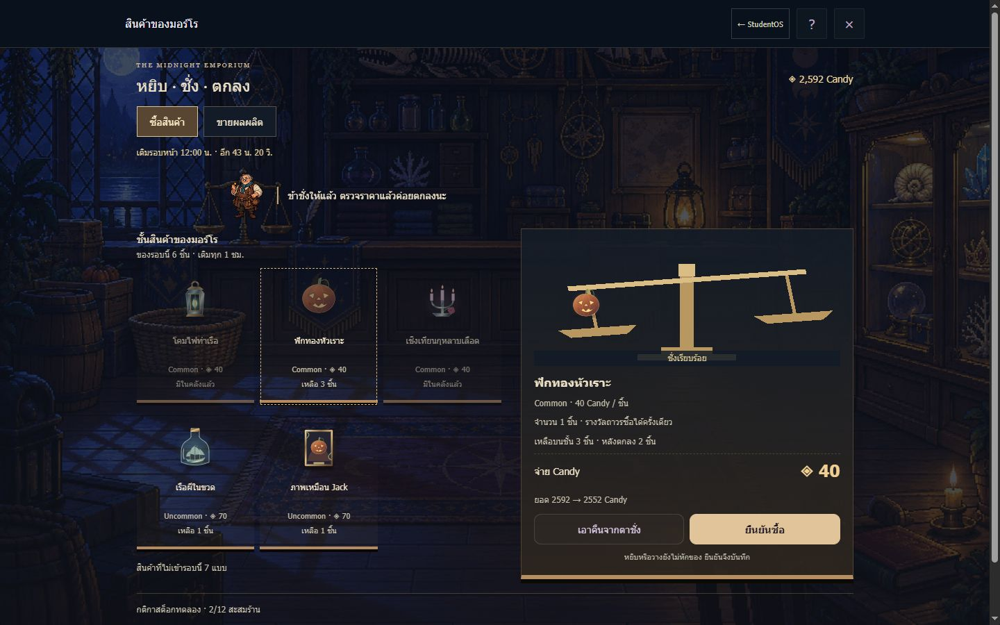
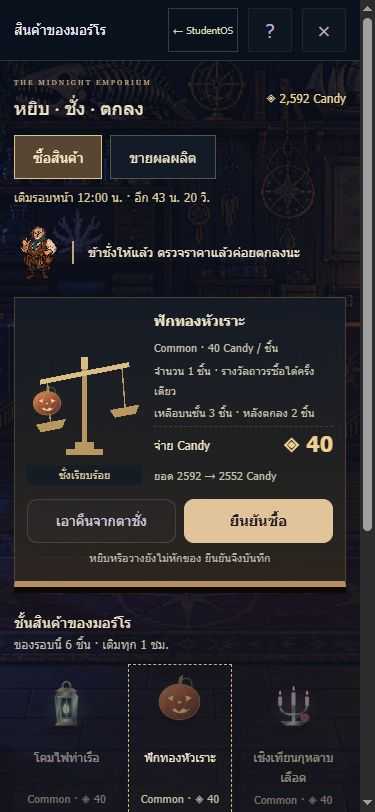
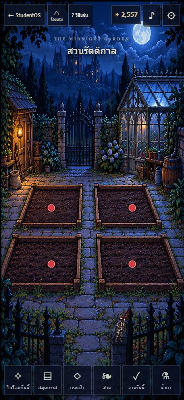
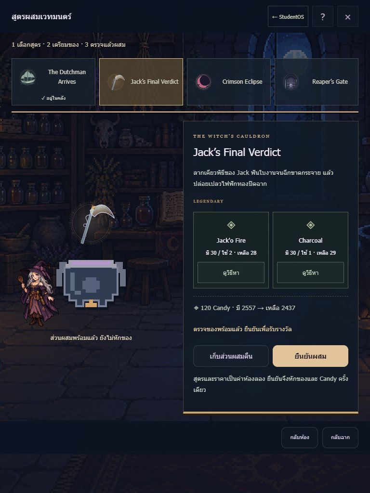
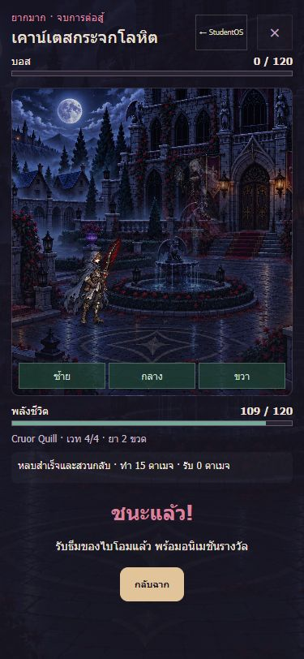

# Halloween RPG · ร้านตาชั่งและเก็บงานฉาก · 24 ตุลาคม 2569

ทำใน ALT บนฐาน `9d797ab` / `codex/studentos-main-desktop` เท่านั้น ยังไม่ได้ push หรือขึ้นเว็บ เลขแอปยัง **1C60** และคีย์ `studentos.alt.*` เดิม ข้อมูลอีเวนต์ยังแยกจากบัญชีจริง `claimingEnabled:false` งานเรียนจริงยังไม่ต่อกับ Candy

## จุดที่เห็นจริงและแก้แล้ว

| ลำดับ | ภาพ/พฤติกรรมเดิมที่ตรวจ | สิ่งที่แก้ |
|---|---|---|
| 1 | ตู้สินค้าเปิดเป็น shop hero + ตัวกรอง + การ์ดรายการยาว หน้ารับซื้อเป็นช่องกรอกจำนวน | เคาน์เตอร์ในฉากร้าน มีชั้นสินค้า พ่อค้า ตาชั่ง และใบราคา ซื้อ/ขายใช้จานเดียวกัน |
| 2 | ปุ่มบ้านหมายถึงโถงเกม แต่ทางกลับ StudentOS อยู่ในตั้งค่า | แยก “← StudentOS” กับ “โถงเกม” บน HUD และใส่ทางกลับในป๊อปอัป มินิเกม และหน้าสู้ |
| 3 | จุดแดงแปลงบนในมือถือไปอยู่บนประตู/เรือนกระจก จุดของแปลงล่างอยู่มุมกรอบ | ย้ายจุดไปกลางดินแต่ละแปลง ปรับตำแหน่งแปลงบนแนวตั้ง รักษาจุดแดง 13px และพื้นที่แตะเดิม |
| 4 | ห้องร้าน/เตา/วงเวทบนคอมมีกรอบนอกและส่วนท้ายต้องเลื่อน | ให้ห้องเต็มเวทีทุกทิศทาง แถบชื่อกับปุ่มกลับซ้อนบนฉาก |
| 5 | สูตรผสมและพิธีเป็นการ์ดรางวัลยาว ไม่เห็นขั้นตอนเตรียม | สมุดเลือกสูตร + หม้อ/วงเวท + NPC + ถาดวัตถุดิบ เห็นจำนวนที่มี/ใช้/เหลือและ Candy ก่อนเตรียมและยืนยัน |
| 6 | คลังเป็นการ์ดรายการใหญ่ วัตถุดิบแตะดูรายละเอียดไม่ได้ | กระเป๋าเป็นช่องของ รางวัลมีภาพ วัตถุดิบมีจำนวน/ระดับและทางดูแหล่งของ ช่องอาวุธและประวัติ Candy ยังคงอยู่ |
| 7 | บ้านห้าช่องบีบข้อความ “เคาะประตู” บนมือถือ | บ้านพิกเซลห้าหลัง มือถือจัดสองคอลัมน์ ประตูมีฉากเคาะ/เปิดพร้อมผลรางวัล |
| 8 | วัชพืชเป็นปุ่มตัวเลขสีเขียว ขุดเป็นช่องสัญลักษณ์ และผีบางตัวซ้อนกันตอนภาพนิ่ง | เถาวัลย์บนสวนจริง มีเลขลำดับและเอฟเฟกต์ตัด ชั้นดิน/พลั่วในสุสาน จัดผีให้แยกตำแหน่ง และใช้ฉากสุสานเป็นพื้นหลัง |

ตรวจภาพโถง สี่ไบโอม ร้าน เตา วงเวท สวน กระเป๋า เควส บ้าน มินิเกมห้าแบบ และหน้าบอสจริงก่อนสรุป จุดแดงในโถงและไบโอมเดิมยังใช้ทิศทางที่เจ้าของเลือก ไม่เพิ่มป้ายค้างหรือปุ่มเดิน สมุดเควสและประวัติ Candy ยังคงเป็นรายการอ่าน เพราะต้องเทียบข้อกำหนดและรายการย้อนหลัง

## ร้านที่เล่นได้จริง

แตะสินค้าเพื่อหยิบ → แตะจานเพื่อวาง → ตรวจชื่อ จำนวน ราคาต่อชิ้น ยอดรวม Candy ก่อน/หลัง และจำนวนของที่เหลือ → ยืนยันซื้อหรือขาย คอมใช้ลากลงจานได้ การหยิบ วาง เพิ่ม/ลดจำนวน เอาคืน ยกเลิกลาก หรือปิดหน้าต่าง **ไม่เขียนธุรกรรมซื้อขาย** มีภาพของเข้าจาน คานตาชั่งเอียง พ่อค้าตอบ และฉากรับของเดิมตามระดับ

รางวัลร้านเป็นของสะสมถาวร ซื้อชื่อเดิมได้ครั้งเดียว จำนวนซื้อจึงเป็น 1 ส่วนผลผลิตเลือกจำนวนด้วยปุ่ม ± ได้ถึงจำนวนที่ปลูกจนโตและเก็บจริงเท่านั้น กุหลาบที่ทดสอบ 2 ชิ้นแสดงราคา 24 Candy ก่อนยืนยัน และหลังขายจำนวนลด 2 พร้อมยอดเพิ่ม 24 ไม่ซื้อ/ขายอัตโนมัติตอนลากวาง

ตรวจใน core อีกครั้งขณะบันทึก: อยู่ห้องร้าน สต็อกรอบเดียวกับที่ชั่ง มีของเหลือ ยังไม่เคยซื้อ และ Candy พอ การซื้อบันทึกยอด สต็อก สิทธิ์ และ receipt ในธุรกรรมเดียว ระบบคิว/lock เดิมยังใช้ ขายตรวจจำนวน inventory และผลผลิตปลูกเองตรงกับใบชั่ง เมื่อสต็อกเปลี่ยนรอบหรือผลผลิตเปลี่ยนจากอีกแท็บให้ชั่งใหม่ กดรัวขณะรอไม่ส่งธุรกรรมซ้ำ

### ค่าสต็อกทดลองที่เสนอใน preview-rules

- เติม **6 ชิ้นต่อเซฟห้องลอง ทุกต้นชั่วโมง** เวลาถัดไปและนับถอยหลังอยู่เหนือเคาน์เตอร์ เห็นได้บนมือถือ
- สุ่มระดับแต่ละชิ้น Common **60%**, Uncommon **30%**, Epic **10%** แล้วสุ่มชื่อในระดับนั้นเท่ากัน ชื่อซ้ำรวมจำนวน ไม่มีการสะสมของเหลือข้ามรอบ
- ขายเฉพาะของแต่งห้อง/เอฟเฟกต์ 12 แบบที่ร้านเดิมขาย ไม่เพิ่มวัตถุดิบ เมล็ด Mystical ของเฉพาะเควส หรือของลัดความคืบหน้า
- นี่เป็น **ข้อเสนอสำหรับพรีวิว ยังไม่ใช่อัตราที่เจ้าของยืนยัน** สต็อกเป็นของเซฟในเครื่อง ไม่ใช่ตลาดร่วมของบัญชีจริง
- แยกจากบ้านโดยสิ้นเชิง: บ้านยัง **4 ชั่วโมง**, ดรอป 60%, ระดับ **40/30/15/10/4/1**, Breakthrough 10% สุ่มปลายทางทั้งสี่เท่ากัน
- ตั้งค่า → เครื่องมือสำหรับลองให้ครบ → **ข้ามเวลาร้าน 1 ชม.** ใช้ทดสอบรีสต็อกได้ ปุ่มข้าม 4 ชม. เดิมยังอยู่ การข้ามเวลาไม่ได้รีเซ็ตบ้าน

สูตรผสมต้องเตรียมก่อนยืนยัน มีปุ่มเก็บส่วนผสมคืน ถ้าของไม่ครบ/ยังไม่ผ่านบอส/รับรางวัลแล้ว ปุ่มเตรียมหรือยืนยันจะปิด ทางดูวิธีหาของยังกลับมาสูตรเดิมได้ ย้ายตัวลองฉากรับของทุกระดับไปเครื่องมือพรีวิวในตั้งค่า จึงไม่กินพื้นที่ร้านจริง

## ขอบเขตที่รักษาไว้

ของบ้าน 37 + Mystical NPC 6, สวนทุกแปลงรอ Jack Q1, เมล็ดจากเควส, วัชพืชเล่นซ้ำไม่ให้ Plot/เมล็ดซ้ำ, เคียว Restricted จน Win Q5, อาวุธถือในฉาก, ชนะผู้พิทักษ์ก่อนธีม → ราชัน → พิธี → บอสลับ บท NPC และรายการเควสต้นฉบับไม่ถูกแก้ ไม่มีการล้างเซฟหรือแจกของให้ผู้เล่นใหม่

## หลักฐานตรวจ

- Halloween **110/110** รวม 30,000 ชิ้นสต็อกร้าน, ขอบต้นชั่วโมง, เซฟเก่าที่ไม่มี metadata ร้าน, ของหมด, Candy ไม่พอ, ใบชั่งเก่า, กดซ้ำ, ที่เก็บข้อมูลล้มเหลว, ผลผลิตปลูกเอง, การยกเลิก/ลาก/แตะ และเส้นทาง RPG เดิมครบ
- เพิ่มกรณีทดสอบก่อน core ร้าน (เดิมตก 7 เคส) และทดลองถอด busy guard แล้วเคสกดรัวตก `2 !== 1` ก่อนคืนโค้ดและรันผ่าน
- Service worker **6/6**, ฉากเดิม **202 กฎ**, syntax และ diff whitespace ผ่าน
- หน้าหลัก/ป๊อปอัป **120 ชุด** = 12 หน้าบน 10 ขนาด: 320×568, 375×812, 390×844, 812×375, 844×390, 768×1024, 1024×768, 1280×720, 1440×900, 2560×1080 ไม่พบล้นแนวนอน ภาพเสีย หรือหน้าเกมหลักเลื่อนนอกฉาก ตรวจ HUD มือถืออีกครั้งหลังปรับพื้นที่กด
- มินิเกมทั้งห้า + หน้าสู้จริง **60 ชุด** บนสิบขนาดเดียวกัน ไม่พบล้นแนวนอนหรือปุ่มเล่นเล็กกว่า 44px (ยอมค่าปัดพิกเซล 0.5px)
- UI จริง: แตะหยิบ/วาง/เอาคืนโดยยอดคงเดิม; ลากเชิงเทียนลงจานบนคอมยังไม่ซื้อ; ยืนยันจ่าย 40 ของลด 1; รีโหลดเก็บสิทธิ์/ยอดเดิม; ขายผลผลิต 2 ได้ 24; เตรียมแล้วผสม Legendary จ่ายครั้งเดียว; ข้ามเวลาร้าน 1 ชม. ได้สต็อก 6 ใหม่และยังมีของเดิม
- เล่นผ่าน UI จริงทั้ง 5 เกม: เรือถูก 6/6 ผิด 0/3, วัชพืช 6/6, จับผิดภาพ 5/5 (ตรวจข้อความแตะผิดและสลับภาพด้วย), ขุด 8/8, ผี 6/6
- UI จริง: Dech Q2 → ข้ามหนึ่งวันในเครื่องมือห้องลอง → Q3 → ถือ Cruor Quill → สู้เคาน์เตส 10 เทิร์น → ชนะ → รับธีม Epic; บอสท้าย/ลับยังมีเงื่อนไขเดิมในชุดทดสอบ core ไม่อ้างว่าเล่นบอสท้ายทุกตัวผ่านเบราว์เซอร์ในรอบนี้
- กลับ `/alt/` ได้จริง กลับเข้าเกมแล้วกระเป๋ายังมีรางวัล 6 ชิ้น รวมเชิงเทียน, Legendary จากหม้อ และธีมผู้พิทักษ์ที่ทดสอบไว้
- ผู้เล่นใหม่ตรวจบน origin แยก เริ่ม 0 Candy ไม่ซื้อของที่เงินไม่พอ เมล็ด 0 และสวนรอ Jack Q1
- เปิด/ปิดเสียงจาก UI ได้ ตรวจอนิเมชันคาน `counter-weigh` เมื่อเปิด และคาน/พ่อค้าเป็น `none` เมื่อเลือกภาพนิ่ง เสียงเคารพ mute/visibility ตามชุดทดสอบเสียงเดิม ไม่อ้างการฟังเสียงหรือวัด FPS บนอุปกรณ์จริง

ทั้งหมดเป็นเบราว์เซอร์ที่ปรับขนาดจอ ไม่ใช่การทดสอบบนโทรศัพท์/iPad จริง ผลวัดอยู่ [counter-layout-2026-10-24.json](counter-layout-2026-10-24.json) และ [counter-game-layout-2026-10-24.json](counter-game-layout-2026-10-24.json)

## ภาพพรีวิวจริง

พรีวิวในเครื่อง: `node alt/halloween/tools/preview.cjs --port=4201` → `http://127.0.0.1:4201/alt/halloween/event/?preview=1#hub` ทดสอบ origin แยกที่พอร์ต 4277 ไม่มีการแก้ข้อมูลเว็บจริง

ก่อนส่งเว็บรอบหน้าให้ fetch/เทียบ origin ใหม่: รอบนี้ Git ติดต่อ GitHub ไม่ได้เพราะ proxy 127.0.0.1 ไม่ตอบ จึงอ้างฐาน HEAD ที่รับส่งต่อมาและ refs ในเครื่องเท่านั้น ไม่มีการ push
