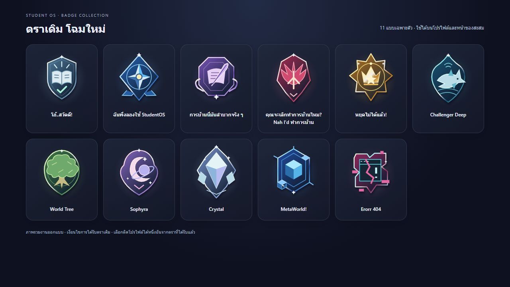
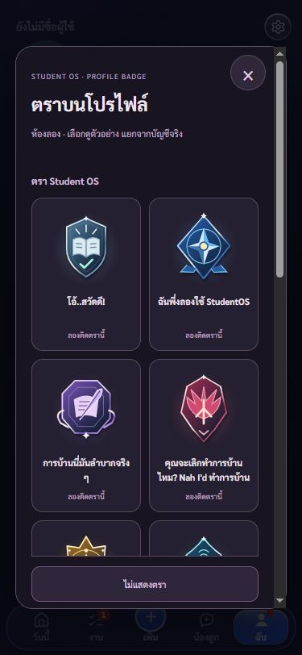
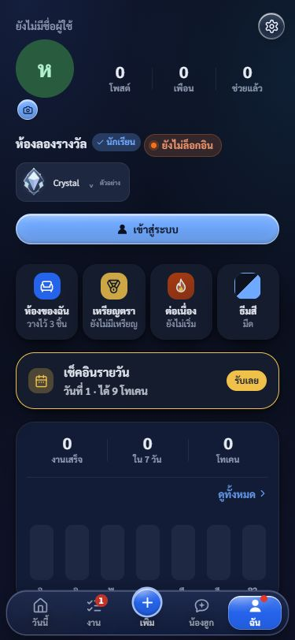

# เลือกตราทั้งหมดและรีโมเดลตราเก่า · 25 ต.ค. 2569

ผู้ใช้ขอเลือกทุกตราและรีโมเดลตราเก่าทั้งชุด ตอนนี้ ฉัน → เลือกตราโปรไฟล์ มีตราปกติ 11 และอีเวนต์ 2 เลือกติดได้หนึ่งอันจากตราที่ได้รับ สลับ/ถอดได้ เพื่อนที่รับแล้วใช้รูปเดียวกัน ชื่อและเงื่อนไขเดิม ไม่เพิ่ม BADGES หรือเปลี่ยนสูตร Crystal

## ภาพ

- SVG ใหม่ 11 ภาพอยู่ใน rewards/profile-assets/ สร้างซ้ำด้วย tools/build-profile-badges.cjs แต่ละภาพมีรูปทรงและสัญลักษณ์เฉพาะ ไม่ใช้วงกลมกับตัวอักษรแบบเดิม
- ใช้ใน renderBadges(), สรุปความสำเร็จหน้า Stats และตัวเลือก/ชิป/รายละเอียดโปรไฟล์ ไม่แตะ style.css
- gallery.html เป็นภาพรวมงานออกแบบ ไม่มีบัญชีหรือการแจกตรา

## บัญชีและฐานข้อมูล

- halloween-badge v2 อ่านงาน/ของสะสมจาก user_state ของ UID ที่ Auth ตรวจ และอ่านใบรับอีเวนต์จาก halloween_states ตราปกติใช้กฎเดิมของ badgeEarned() (ทดสอบ metadata ตรงกับ BADGES) จำนวนงานไม่นับงานลบ ธงโค้ดปลดล็อกยังตามระบบเดิม ส่วน MetaWorld/404 ต้องมีสกินจริง
- สิทธิ์ตราปกติยังอิงข้อมูลซิงก์ที่แอปเดิมแก้ไขได้ ไม่อ้างว่าเป็นใบรับกันโกงแบบอีเวนต์ และไม่รับรายการ owned หรือ owner จากคำสั่ง equip
- vaultExport/Import พก badgeSecrets สามสิทธิ์เดิมด้วย รวมแบบปลดแล้วไม่หายตามของสะสมอื่น ใช้คีย์เดิมที่ระบบสลับบัญชีแยกอยู่แล้ว ก่อนเปิดตัวเลือกซิงก์งานกับบัญชีและอ่านสิทธิ์ใหม่
- ตารางเลือกเดิมยังหนึ่งแถวต่อ UID ผู้อ่าน/RLS/สิทธิ์เขียนเดิม คำว่า season ใช้ studentos สำหรับตราปกติ และ halloween-2026 สำหรับอีเวนต์ Migration 20261025142719 ยก FK ไปเซฟอีเวนต์ออกเพื่อให้คนไม่เล่นอีเวนต์ติดตราปกติได้ แต่คง FK auth.users พร้อม check คู่ ID/scope
- Browser เลือกได้จาก available ที่บริการตอบ ไม่เขียนตารางตรง ไม่เปิดเผยงานหรือใบรับแก่เพื่อน ตราปกติไม่มีวันรับเดิมจึงไม่แต่งวันที่

## ตรวจจริง

- เห็น RED ก่อนขยายเลือกตราและภาพใหม่ และถอดบรรทัด vault เพิ่มออกเพื่อเห็นการย้ายเครื่องตกก่อนคืนโค้ด
- Halloween 231/231, account switch 33/33, sync 36/36, service worker 6/6, syntax และ diff check ผ่าน
- RLS จริง 10 ข้อ rollback ทั้งหมด: เจ้าของ/เพื่อนอ่านได้ คนนอก/คำขอรอ/บล็อกอ่านไม่ได้ Browser เขียนไม่ได้ anon อ่านไม่ได้ เอกสารรางวัลยังปิด ตราปกติไม่ต้องมีเซฟอีเวนต์ และ ID ผิด scope ถูกปฏิเสธ ไม่มี advisor finding อ้างตารางนี้
- UI แอปจริงในห้องลอง: เลือกครบ 13 แบบ ภาพทั้ง 11 ในของสะสมโหลดได้ ตรวจ 375×812, 320×568, 1280×900 ทั้ง 13 ปุ่มไม่ล้นและไม่มีภาพเสีย (ui-checks.json)
- qa.html สองบัญชีสมมติ: A เลือก World Tree แล้ว B เห็น/เปิดรายละเอียด B เลือกตราที่ยังไม่ได้นั้นไม่ได้ แต่เลือก hello ได้ ออกจากระบบเหลือ 0 ชิป
- ห้องลองเป็น memory ไม่ให้รางวัลบัญชีจริง ยังไม่ได้ทดสอบสองมนุษย์บนสองเครื่องจริง

