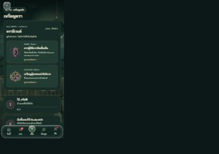
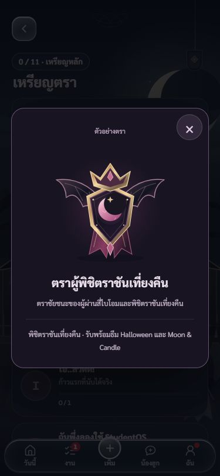
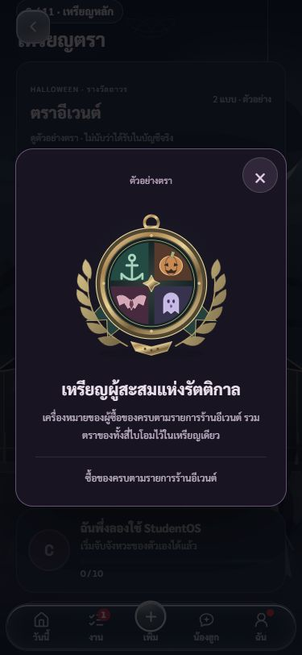

# ตราอีเวนต์ในหน้าเหรียญตรา · 25 ตุลาคม 2569

เจ้าของไม่พบตราอีเวนต์ในแอป และทักว่าตราสองอันหน้าตาคล้ายกันเกินไป

## ผลงาน

- หน้าแรก **ของสะสม → เหรียญตรา → ตราอีเวนต์** แสดงสองตราอยู่เหนือเหรียญหลัก กดดูรูปใหญ่และเงื่อนไขได้
- **ตราผู้พิชิตราชันเที่ยงคืน** เปลี่ยนเป็นโล่ออบซิเดียนทรงแหลม มงกุฎ ปีกค้างคาว จันทราคราสสีไวน์ และแพรยาว
- **เหรียญผู้สะสมแห่งรัตติกาล** เปลี่ยนเป็นเหรียญเข็มทิศวงกลม ช่อลอเรล สมอเรือ ฟักทอง ค้างคาว และวิญญาณ รวมสีสี่ไบโอม ไม่มีมงกุฎหรือโล่ร่วมกับตราผู้พิชิต
- แก้ SVG ต้นฉบับที่ `rewards/assets/` ทุกหน้าที่ใช้สองไฟล์นี้จึงได้งานใหม่ด้วย ไม่เปลี่ยน ID หรือเงื่อนไขรับตรา

## สิทธิ์และการแสดงผล

โมดูล `rewards/badges.js/css` เป็นส่วนแสดงผลถาวร แยกจาก `event/` ใช้ `HalloweenAccount.create` และ read เดิมเฉพาะเมื่อเปิดหน้าเหรียญตรา ไม่ส่งคำสั่งรับรางวัลหรือเขียนเซฟ

บัญชีจริงต้องมี owner ตรงบัญชีที่เปิด พร้อม reward ID / permanent / receipt ที่อ่านจากบริการบัญชี จึงแสดงว่าได้รับแล้ว ไม่อนุมานจากธีม จำนวนงาน หรือโค้ดเปิดเหรียญทั่วไป ไม่อ่านเซฟพรีวิวมาเป็นสิทธิ์จริง ระหว่างรอตรวจ/เข้าสู่ระบบ/เน็ตขาดแสดง **— / 2** พร้อมสถานะ ไม่แปลว่าตราหายหรือยังไม่ได้รับ

ห้องลองแสดงทั้งสองรูปพร้อมคำว่า **ตัวอย่าง** ไม่สร้าง reader ของบัญชี ไม่ปลอมว่าได้ตรา เก็บตัวนับเหรียญหลัก 11 อันและตราอีเวนต์แยกกัน คงสูตรปลดล็อก Crystal เดิม

อ่านซ้ำมีคิวเดียวและเก็บผลยืนยันไว้ 30 วินาที กดตรวจอีกครั้งหรือกลับมาจากพื้นหลังตรวจใหม่ได้ เปลี่ยนบัญชี/ออกจากระบบล้างผลเดิมและทิ้งคำตอบที่มาช้าของบัญชีก่อน ไม่มีคีย์ localStorage ใหม่

## ตรวจแล้ว

- เทสต์ใหม่ RED ก่อนเพิ่มโมดูล แล้วผ่าน 8 เคส: สองตรา, สิทธิ์ปลอม/คนละบัญชี/ห้องลอง, อ่านซ้ำ, คำตอบเก่ามาช้า, ออกจากระบบ, เปลี่ยนก่อนเริ่มคำขอ, auth clear และลองใหม่เมื่อบริการล้ม
- Halloween **202/202**, สลับบัญชีแอปเดิม **33/33**, service worker **6/6**, scene-check **207 กฎผ่าน**, SVG XML สองไฟล์และ diff-check ผ่าน
- เปิดหน้าเหรียญตราผ่านปุ่มจริงในห้องลองและโหมดผู้เยี่ยมชม ผู้เยี่ยมชมแสดงรอตรวจ **— / 2** และเหรียญหลักครบ 11 อัน
- เปิดรายละเอียดทั้งสองแบบที่ 375×812, 320×568, 1280×900 รูปโหลดครบ กล่องไม่ล้นแนวนอน/ขอบจอและปุ่มปิดยังเห็น ผลใน `ui-checks.json`
- ห้องลองไม่พบ console error ทดสอบสิทธิ์สำเร็จ/สลับบัญชีด้วยตัวจำลอง ไม่ได้ลงชื่อบัญชีเจ้าของหรือรับตราจริงเพื่อทดสอบ ยังไม่ได้ลองมือถือจริง
- คงเลขแอป **1C60** ออฟไลน์เพิ่มเป็น 66 ไฟล์ และ cache tag `boot-badges-20261025` ไม่แก้ backend หรือกติกา

