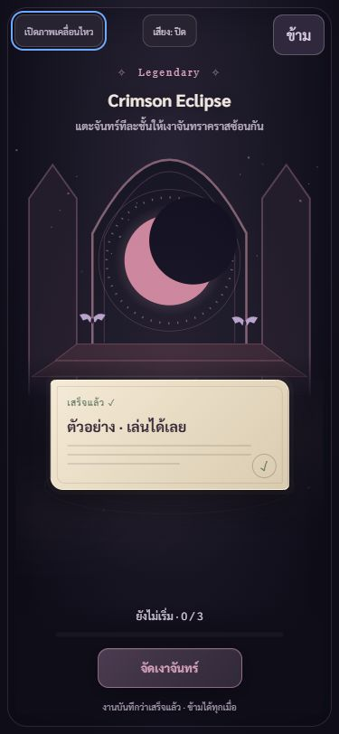
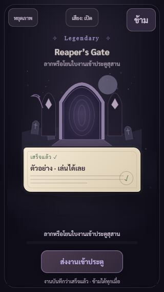

# เอฟเฟกต์งานเสร็จ Halloween · 25 ตุลาคม 2569

เจ้าของขอให้กลับไปลองเอฟเฟกต์เก่า แล้วนำจังหวะ/การตอบสนองมาทำให้รางวัล Halloween เล่นสนุกและมีน้ำหนักขึ้น ทำเฉพาะ ALT คงเลขแอป 1C60

ของเก่าที่ตรวจ: `hoop.js` และ `fxgames.js` มีแรงปล่อย กระทบเป้าหมาย เสียงตามจังหวะ และลองใหม่ได้ ลองโยนบาสกับปาดผลไม้ผ่านหน้าร้านค้าจริงก่อนปรับ ไม่ได้อ้างว่าชนะสองเกมนั้น

## ที่เปลี่ยน

| เอฟเฟกต์ | ฉากและการตอบสนอง |
|---|---|
| รอยคลื่นวิญญาณ | ท่าเรือ โคมสามดวงสว่างตามลำดับ เรือออกเมื่อส่งแสงครบ |
| ประกายฟักทอง | หมู่บ้านและฟักทองสามลูก จุดใบหน้าและสะเก็ดทีละลูก |
| ปีกกำมะหยี่ | หน้าต่างปราสาท ฝูงค้างคาวขยับปีกและบินรับงาน |
| ดอกไม้วิญญาณ | สุสาน ดอกไม้สี่ต้นเติบโตตามที่แตะจนบานครบ |
| The Dutchman Arrives | เรือเดิมจากธีมจริง คลื่นสองระยะ รับงานแล้วแล่นลับไป |
| Jack’s Final Verdict | เคียวเหนือไร่ รอยฟันแต่ละจังหวะ กระดาษแปดชิ้นเมื่อฟันครบสามครั้ง |
| Crimson Eclipse | หน้าต่างปราสาท เงาซ้อนจันทร์สามชั้น วงแสงหลังจัดครบ |
| Reaper’s Gate | ผู้เฝ้าประตูและวงหมุนวิญญาณ กลืนงานแล้วประตูค่อยปิด |

ใช้เวกเตอร์และ CSS ใน `effect-stage.js/css` รูปสินค้าในร้านยังใช้ของเดิม ฉากถาวรโหลดได้โดยไม่พึ่ง `event/` และ manifest เพิ่มเป็น 64 รายการ

ปล่อยกระดาษขึ้นด้านบนได้ โดยคำนวณแนวปล่อยสั้น ๆ จากความเร็วล่าสุด ช่วยไม่เกิน 170px ต้องตัดผ่านเป้าหมายจริง ไม่ใช่ฟิสิกส์เต็มสนามแบบบาส ลากวางตรง ๆ และปุ่มเล่นสำรองยังใช้ได้ พลาดแล้วลองใหม่ไม่จำกัด กระดาษออกจากตำแหน่งที่ปล่อยโดยไม่กระโดดกลับกลางก่อนบิน

เสียงสังเคราะห์สั้นตามไบโอม เริ่มหลังแตะเท่านั้น ใช้คีย์เปิดเสียงเดิม `studentos.alt.doneFxSound` ปิดแล้วจำค่า มีเพดาน 12 เสียง ปิด AudioContext ของตัวเองเมื่อออก ตั้ง ambient บนระบบที่รองรับ ไม่ได้ใช้ไฟล์เสียงภายนอกหรือเสียงพูดเพิ่มในชุดนี้

ฉากปิด Epic 1.9 วินาที / Legendary 2.8 วินาที / ภาพนิ่ง 0.65 วินาที ข้ามได้ทุกเมื่อ งานบันทึกเสร็จก่อนเปิดฉากเสมอ ไม่มีการให้ Candy เปลี่ยนสิทธิ์ ปิดงานใหม่ หรือแก้บัญชี เซิร์ฟเวอร์ และเรทสุ่ม

จำกัดประกาย 64 ชิ้นและประวัติการลาก 256 จุด ไม่มีลูป JavaScript ต่อเฟรม ภาพนิ่งหยุด CSS รวม pseudo-elements และล้างประกายทันที ออกหน้าฉากแล้วล้างเวลา/เสียง คืนโฟกัสเดิม รองรับ Escape และวน Tab อยู่ในกล่อง

## หลักฐานตรวจ

- เขียนเทสต์ก่อนเพิ่มโมดูล เห็น RED จากโมดูลที่ยังไม่มี แล้วผ่าน 8 เคสเฉพาะเอฟเฟกต์
- Halloween รวม **194/194**, service worker **6/6**, scene-check **207 กฎผ่าน**, syntax และ diff-check ผ่าน
- เล่นครบทั้งแปดผ่านปุ่มในร้านค้า เห็นสถานะสำเร็จและฉาก SVG ทุกแบบ รายละเอียด `ui-checks.json`
- ลากขึ้นเรือจริงสำเร็จ ปาด Jack จริงสามครั้งได้กระดาษแตกแปดชิ้น ลาก Reaper ผิดทิศไม่ผ่านแล้วลองใหม่สำเร็จ
- ลองกดโคมผิดลำดับแล้วให้คำใบ้ถูก ตรวจภาพนิ่ง: animation-name ไม่เหลือ, ประกาย 0 ตรวจปิดเสียงแล้วเปิดฉากอื่นยังปิด และ Tab จากปุ่มเสียงกลับปุ่มภาพ
- ตรวจ 8 ฉาก × 3 ขนาด: 375×812, 320×568, 1280×900 ปุ่มอยู่ในกรอบครบ หน้าแรก 375×812 สูง/scrollHeight 803px เท่ากัน
- กลับร้านไม่มี dialog/ประกายค้าง โฟกัสคืนปุ่มลอง ไม่พบ console error ของแอป
- ยังไม่ได้ลองมือถือจริง วัด FPS หรือฟังเสียงผ่านลำโพงอุปกรณ์จริง จึงไม่อ้างผลส่วนนี้

