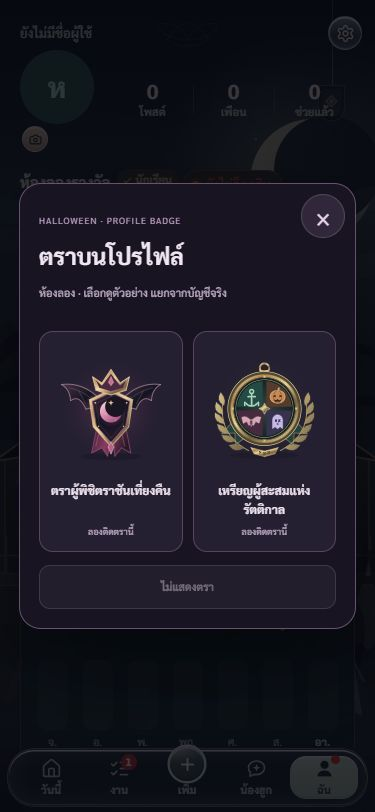
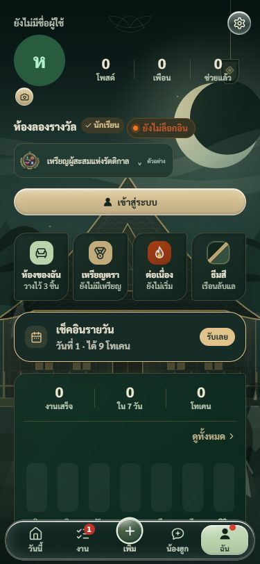

# ติดตราบนโปรไฟล์ · 25 ตุลาคม 2569

เจ้าของตอบรับให้ทำข้อเสนอ “ติดตราที่โปรไฟล์ได้ 1 อัน” พร้อมแสดงในหน้าเพื่อน

- ใต้ชื่อในแท็บ **ฉัน** มี **เลือกตราโปรไฟล์** แตะตราที่ได้รับแล้วเพื่อติด สลับได้ และเลือก **ไม่แสดงตรา** เพื่อถอด
- เก็บหนึ่งตัวเลือกต่อบัญชีบนเซิร์ฟเวอร์ ให้ตามไปเมื่อเปลี่ยนเครื่อง ไม่เก็บตัวเลือกจริงไว้ใน localStorage
- หน้าโปรไฟล์ของเพื่อนและแถวรายชื่อเพื่อนใช้รูปตราที่เลือก กดดูรูปใหญ่ คำอธิบาย และวันที่ได้รับถ้าข้อมูลเดิมระบุไว้
- เพื่อนที่รับแล้วเท่านั้นที่อ่านตราได้ คนที่ไม่ได้เป็นเพื่อน/คำขอที่ยังไม่รับ/คนบล็อกกันอ่านไม่ได้ ผู้ใช้เป็นคนเลือกว่าจะเปิดแสดงหรือไม่
- ห้องลองเลือกทั้งสองแบบเพื่อดูตัวอย่างได้ แต่เป็นหน่วยความจำแยก ไม่ให้ตราจริงหรือส่งข้อมูลออกไป
- คงตราสองแบบ เงื่อนไขรางวัล เลข 1C60 และสูตรเหรียญ/Crystal เดิม

## โครงที่ดูแลต่อ

UI อยู่ใน `rewards/featured-badge.js/css` แทรกช่องแสดงผ่าน `profileHeadHTML()` ตัวเดิมใน feed.js และ `frName()` ใน app.js ใช้ reader รางวัลเดิมจาก badges.js เพื่อไม่อนุมานสิทธิ์จากธีมหรือจำนวนงาน

บริการถาวรแยก `halloween-badge` อยู่ใน `server/featured/` ตรวจบัญชีและใบรับรางวัลจริงก่อนบันทึกตัวเลือก ใช้ตารางฉายข้อมูลใหม่นอกเอกสารอีเวนต์ส่วนตัว อ่านแบบกลุ่มไม่เกิน 200 ID และเก็บผลไว้ 30 วินาที เปลี่ยนบัญชีทิ้งผลเก่าและไม่รับคำตอบที่มาช้า เขียนพลาดไม่โชว์ตัวเลือกใหม่ว่าสำเร็จ ให้ตรวจยืนยันอีกครั้ง

ไฟล์ฐานข้อมูลอยู่ใน `alt/supabase/migrations/20261025134306_featured_halloween_badge.sql` จำกัดสิทธิ์อ่านด้วย RLS และไม่ให้เบราว์เซอร์เขียนเอง ไม่เปลี่ยนบริการเล่นอีเวนต์หรือขยายสิทธิ์อ่านโปรไฟล์เดิม

## ตรวจแล้ว

- เทสต์ใหม่เห็น RED ก่อนเพิ่มโมดูล ทั้งการเลือก/ถอด เปลี่ยนบัญชี คำตอบเก่า เน็ตขาด คิวซ้ำ ไคลเอนต์ล้มทันที ใบรับปลอม/ผิดเจ้าของ และการส่ง JWT กับสิทธิ์ฝั่งบริการ
- ฐานข้อมูลจริง: เจ้าของ/เพื่อนที่รับแล้วอ่านได้ คนนอก/คำขอที่รอ/บล็อกอ่านไม่ได้ เบราว์เซอร์เขียนไม่ได้ ผู้เยี่ยมชมอ่านไม่ได้ เอกสารรางวัลส่วนตัวยังปิด ข้อมูลจำลองทั้งหมด rollback
- หน้าจริงในห้องลอง: เลือกทั้งสองตรา สลับและถอด ตรวจ 375×812, 320×568, 1280×900 โดยบันทึกขนาดจริงใน `ui-checks.json` กล่องไม่ล้นแนวนอนและอยู่ในจอ
- `qa.html` ทดสอบ UI ด้วยสองบัญชีสมมติในหน่วยความจำ: เพื่อนเห็นตราและวันที่รับ ตราที่ยังไม่ได้รับกดเลือกไม่ได้ และออกจากระบบแล้วไม่เหลือตราเก่า รูป qa-friend-detail.png เป็นข้อมูลสมมติ ไม่ใช่ตราที่เจ้าของได้รับจริง
- ชุดทดสอบและสถานะเผยแพร่ล่าสุดดู PATCHNOTES/HANDOFF บริการ v1 ACTIVE/JWT, POST ไม่เข้าสู่ระบบ401 และ OPTIONSจากALT204
- ยังไม่ได้ใช้สองบัญชีมนุษย์บนสองเครื่องจริงหรือทดสอบมือถือจริง จึงไม่อ้างผลส่วนนั้น

